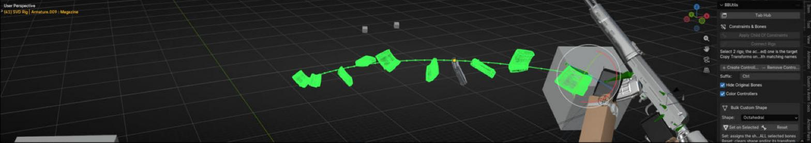
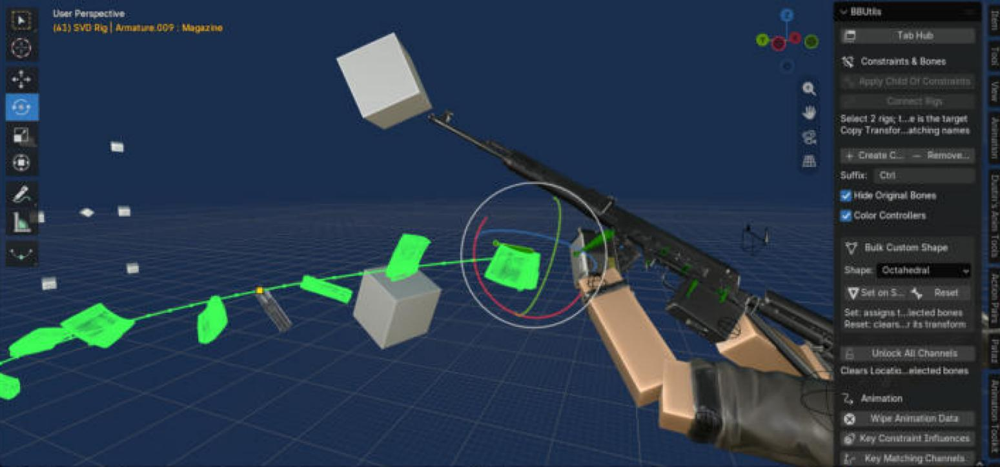
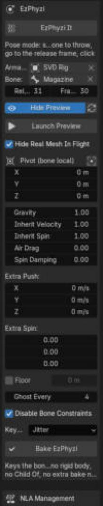
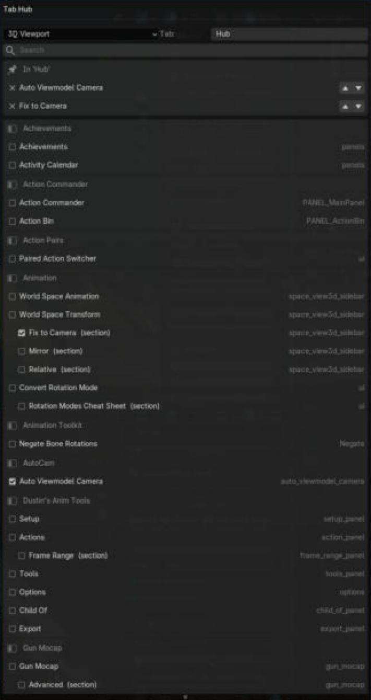
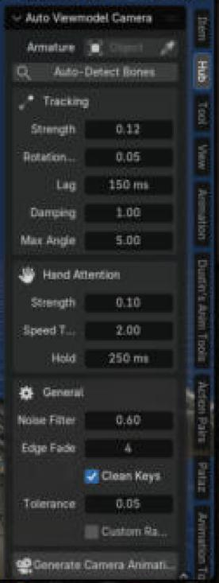

# BBUtils

**A toolbox for game and viewmodel animators in Blender.** Throw a magazine with one click
and see the flight before you bake it, collect your scattered add-on tabs into one,
batch-render every action, and stop doing rig chores by hand.



> Blender **4.2+** (developed and tested on 5.3) · Free for non-commercial use (CC BY-NC-ND 4.0)

---

## Contents

- [Highlights](#highlights)
- [Install](#install)
- [EzPhyzi: throw physics without rigid bodies](#ezphyzi-throw-physics-without-rigid-bodies)
- [Tab Hub: one tab for all your add-ons](#tab-hub-one-tab-for-all-your-add-ons)
- [Animation tools](#animation-tools)
- [Transform Clipboard](#transform-clipboard)
- [Rig and bone tools](#rig-and-bone-tools)
- [NLA and F-Curve tools](#nla-and-f-curve-tools)
- [Batch viewport render](#batch-viewport-render)
- [Where to find everything](#where-to-find-everything)
- [Building from source](#building-from-source)

---

## Highlights

| | |
|---|---|
| **EzPhyzi** | Throw a magazine, shell or pin off a bone. You get a live trajectory preview, a one-shot launch preview and a one-click bake straight onto the bone. No rigid body, duplicate mesh, Child Of or second bake. |
| **Tab Hub** | Move whole panels, or single sections of panels, from any add-on into one sidebar tab that sits at the top of the tab strip. |
| **Bake Between Keyframes** | Bake only the frames between two selected keys and keep constraint influences intact. |
| **Bulk custom shapes** | Give every selected bone the same custom shape in one go. You can use one of 8 built-in presets or any object. |
| **Batch render** | Render every action of a rig to its own MP4 with viewport shading. |

---

## Install

1. Download the latest `BBUtils-x.y.z.zip` from [Releases](../../releases).
2. In Blender go to **Edit → Preferences → Get Extensions → ⌄ (top right) → Install from Disk…** and pick the zip.
3. Open the sidebar (**N**) in the 3D Viewport, Dope Sheet or Graph Editor and click the **BBUtils** tab.

> If you are updating from an old single-file `BBUtils.py`, disable that add-on first.

---

## EzPhyzi: throw physics without rigid bodies



The usual way to throw a magazine in a viewmodel animation takes a lot of steps:

```
duplicate mesh → add rigid body → bake the scene → parent to the bone → toggle "Animated"
→ tweak gravity and mass → bake the copy → Child Of the real mag → Bake Between Keyframes
```

With EzPhyzi it takes three:

1. In **Pose Mode** select the magazine bone, go to the frame where it leaves the hand and click **EzPhyzi It**.
2. Adjust **Start Frame** and **End Frame** (right under the button) and the sliders while you watch the green trajectory. Every change updates the preview at once.
3. Click **Bake EzPhyzi**.

### How it works

A thrown magazine flies freely, so EzPhyzi integrates the flight itself instead of running Bullet:

- **Start velocity and spin come from your animation.** EzPhyzi measures how the bone moves between the frame before release and the release frame. A flick of the hand becomes the throw.
- **The simulation is cheap,** so the overlay updates live while you drag a slider.
- **The preview follows the rig.** Move the bone on the start frame, or edit its keys, and the throw re-simulates by itself.
- **The bake keys the bone directly** in pose space. With **Clean Curves** (default) it keeps only the keys the flight needs, as Bezier curves with aligned handles: a parabola is exactly one Bezier segment, so a plain throw gets 2 location keys per axis and a handful of rotation keys. Turn it off to get one key per frame. Euler and quaternion rotations are kept continuous, so there are no 360° flips, and the bone's constraints are keyed to influence 0 from the release frame.

### Preview

| Overlay element | What it shows |
|---|---|
| Green line + dots | Flight path, one dot per frame |
| Green wire ghosts | The mesh every *N* frames |
| Solid grey copy | The mesh on the current frame (it is depth-tested, so hands and the gun cover it) |
| Orange ticks | The bone's orientation along the path |
| Yellow dot | The **pivot**, the point the object spins around |

- **During playback** the view gets out of the way: only the path, the grey simulated mesh and the pivot are drawn, without ticks, wire ghosts or frame dots.
- With **Overlays → Extras** off, the path and ghosts hide but the grey simulated mesh stays, so you still see where the object goes.
- Scene geometry (hands, gun) hides the overlay. Turn on **Display → In Front** to draw it on top.
- Settings live in collapsible sections (Display, Pivot, Physics, Extra Push & Spin), so the panel stays short.

### Settings



| Setting | Meaning |
|---|---|
| Start Frame | Release frame, right under **EzPhyzi It**. The 🕒 button sets it to the current frame. Changing it refreshes the preview at once. |
| End Frame | Last frame of the throw, right under Start Frame, with the same 🕒 button. It moves along when the start frame passes it. |
| Pivot (bone local) | Spin centre as an XYZ offset from the bone head in the bone's local space. It snaps to the mesh centre whenever you pick a bone, and the ⌖ button snaps it back. |
| Gravity | Multiplier of the scene gravity |
| Inherit Velocity / Spin | How much of the animated hand motion the object keeps |
| Extra Push / Extra Spin | Extra velocity / angular velocity at release, in bone-local axes |
| Air Drag / Spin Damping | Damping per second |
| Floor, Bounce, Friction | Optional floor plane with restitution and sliding friction |
| Clean Curves, Tolerance | Bake as few Bezier keys as possible with aligned handles. Tolerance is how far the curve may drift from the simulation, as a fraction of each channel's range (higher = fewer keys). |
| Key Type | Keyframe type of the baked keys (**Jitter** by default, also Generated, Breakdown, …) |

EzPhyzi finds the geometry that belongs to the bone in any of these setups:
bone → mesh, bone → empty → … → mesh, objects using Child Of / Copy Transforms on the bone,
and mesh parts skinned to the bone (vertex group weight ≥ 0.5). The same goes for bones
that follow the picked bone (its child bones, or bones that copy it with Copy Transforms),
so a control bone that drives the real mag bone works too.

<br clear="right">

---

## Tab Hub: one tab for all your add-ons

With a lot of add-ons installed you end up scrolling a long strip of sidebar tabs.
Tab Hub lets you pick the panels you actually use and moves them into one tab.

<p>
  
  &nbsp;
  
</p>

- Click **Tab Hub** at the top of any BBUtils panel. The **Collect Panels** page lists every tab in that editor; unfold a tab to see its panels and their **sections**.
- Tick a **panel** to move it with all of its sections, or tick just one **section**. The section is lifted out of its parent and becomes its own panel in the hub.
- The hub tab sits right under **Item**, at the top of the strip, and the other tabs keep their order.
- **Hub In** chooses the editor that holds the hub. Set it to *Dope Sheet* and you can collect panels from the 3D Viewport (or any other editor) right next to your keys. Panels from other editors are copied there, so the originals stay in their tabs. A copied panel runs its add-on's own code in the new editor; most work, but a panel that relies on 3D-viewport-only context may not.
- Reorder hub panels with the arrows. Untick a panel to send it back.
- Your choices are saved in the add-on preferences. A small watchdog re-applies them when other add-ons register or reload their panels.
- It works in the 3D Viewport, Dope Sheet, Graph Editor, NLA, Node, Image, Sequencer, Clip and Text editors.

### Tab Order

The **Tab Order** page of the same dialog lists every sidebar tab of the chosen editor. Use the arrows to move a tab up, down or to the top, for example to bring BBUtils up from the bottom of the strip. The order is saved in the add-on preferences and re-applied on startup. The ↺ button forgets it. (In the 3D Viewport **Item** always stays first, because it is built into Blender.)

> Tip: Blender can also show a single panel on every tab without any add-on. Right-click the panel header and choose **Pin**.

---

## Animation tools

| Tool | What it does |
|---|---|
| **Bake Between Keyframes** | Select two or more keys and the selected bones are baked between the first and last one. You choose the frame step and handle type. Constraint influences are re-keyed, so the result does not double-transform. |
| **Wipe Animation Data** | Removes every F-Curve of the selected bones, in all actions or only in the active one. |
| **Key Constraint Influences** | Keys the influence of every constraint on the selected bones at the current frame, optionally in every action of the rig. |
| **Key Matching Channels** | At the current frame, keys every channel of the active action in all the other actions too. |

## Transform Clipboard

| Tool | What it does |
|---|---|
| **Copy World / Paste** | Copies the world transform of the active bone (Pose Mode) or object and pastes it onto the active bone or object, e.g. to match a weapon to a hand on another frame. |
| **Copy Relative / Paste** | With exactly two bones or two objects selected, copies where the active one sits relative to the other, then puts it back at that offset on any frame. |

Pasting accounts for constraints (Child Of with any influence, Copy Transforms…), so the
result lands exactly where you copied it. With Auto Keying on, the pasted transform is keyed.

## Audio

**Mute Audio** and **Scrubbing** toggles, in the 3D Viewport and Dope Sheet.

## Rig and bone tools

| Tool | What it does |
|---|---|
| **Apply Child Of Constraints** | Copies Child Of constraints from one armature to the same-named bones of another. |
| **Connect Rigs** | Adds Copy Transforms on every bone of one rig, targeting the same-named bone of the active rig. |
| **Create / Remove Controllers** | Creates controller bones (with a suffix, optional colour, original bones hidden) that drive the selected bones through Copy Transforms. Remove cleans them up again. |
| **Bulk Custom Shape** | Assigns one custom shape to all selected bones. Presets: Octahedral, Stick, B-Bone, Envelope, Wire, Sphere, Cube, Circle, or any mesh/curve object. **Reset** clears the shape or its transform. |
| **Unlock All Channels** | Clears the location/rotation/scale padlocks on the selected bones. |

## NLA and F-Curve tools

| Tool | What it does |
|---|---|
| **Stash All Actions** | Pushes every action of the rig into NLA tracks. |
| **Delete All NLA Tracks** | Removes every NLA track from every object in the scene. |
| **Flip F-Curve** | Flips the selected curves and their handles vertically, keeping the first and last key in place. |

## Batch viewport render

Renders **every action** of an armature to its own **MP4 (H.264)** with viewport shading
through the camera you pick. It supports a resolution and scale override, a custom frame
range and a name filter (render only actions whose name contains some text).
Your render settings are restored afterwards.

**Burn-in notes and metadata:** turn on **Output Properties → Metadata → Burn Into Image**
and every video gets the fields you ticked there (frame, date, camera…). The **Note** can
use tokens that are filled in per video: `{action}` `{rig}` `{index}` `{count}` `{start}`
`{end}` `{blend}`. For example `{action} ({index}/{count})` writes `reload (3/12)`.

---

## Where to find everything

| Editor | Sidebar (N) → BBUtils |
|---|---|
| 3D Viewport | Tab Hub · Constraints & Bones · Bone Shapes & Locks · Animation · Transform Clipboard · **EzPhyzi** · NLA · F-Curves · Audio · Batch Render |
| Dope Sheet | Tab Hub · Keyframe Management · Baking · **EzPhyzi** · NLA · Audio |
| Graph Editor | Tab Hub · F-Curve Tools · Animation Tools |

Every category is its own collapsible sub-panel. Blender remembers what you collapsed, and you can reorder categories by dragging their ⠿ handle.

---

## Building from source

The whole add-on is one file, `BBUtils.py`. To build the installable extension zip:

```bash
python build.py
```

The zip goes to `dist/BBUtils-<version>.zip`. The version is read from `bl_info` and
copied into `blender_manifest.toml`.

## License

Creative Commons Attribution-NonCommercial-NoDerivatives 4.0 International. See [LICENSE.txt](LICENSE.txt) for details.
